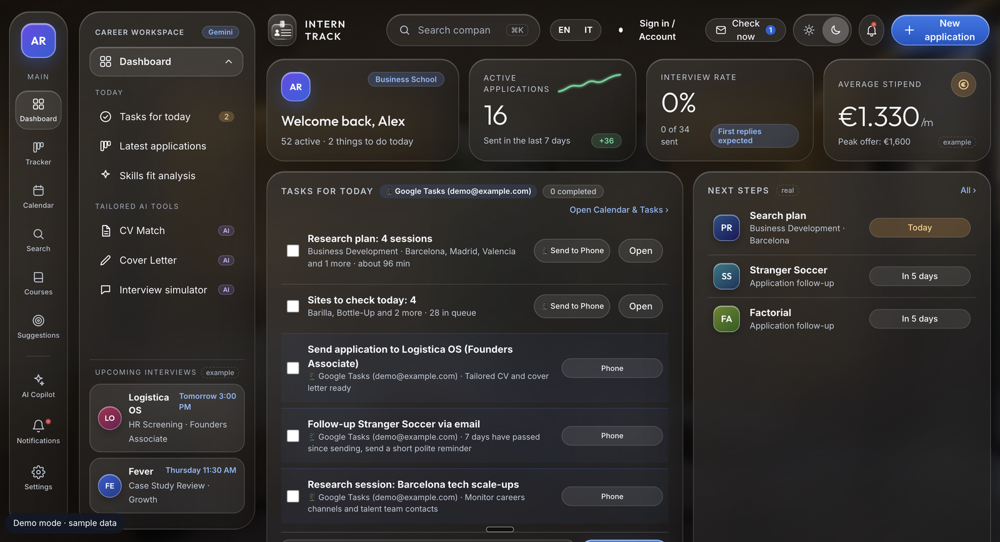
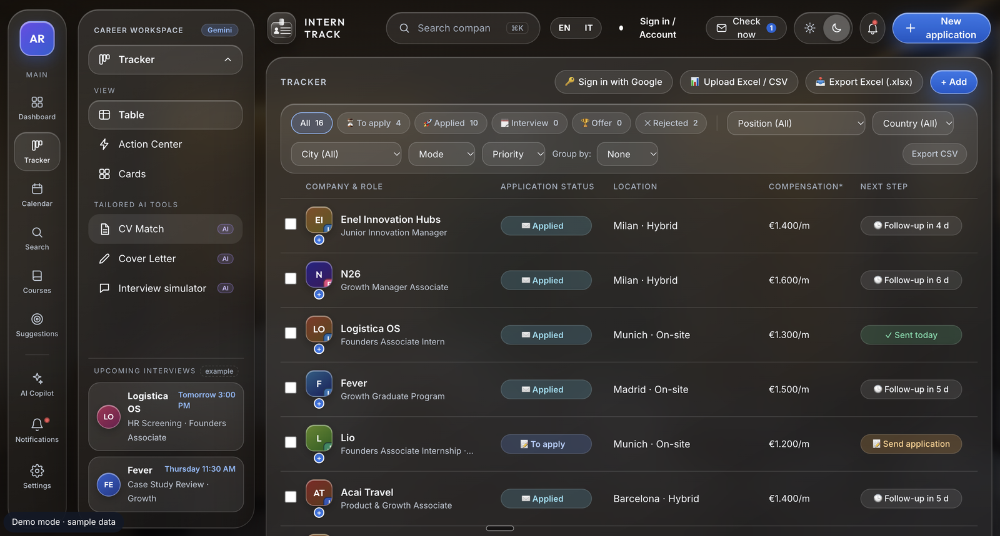
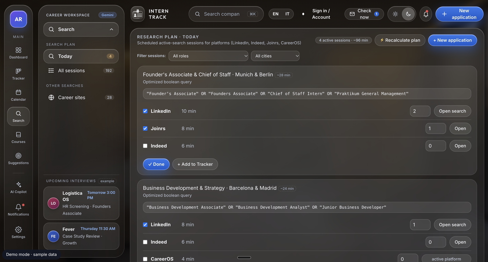
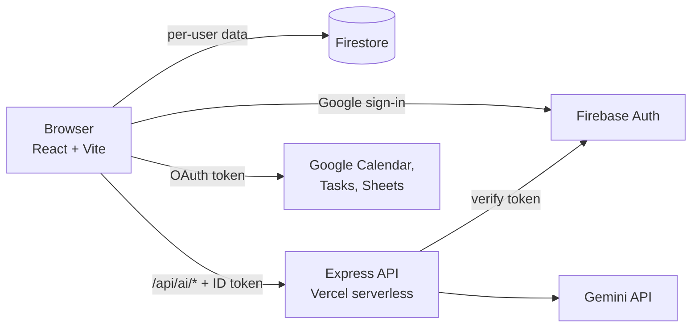
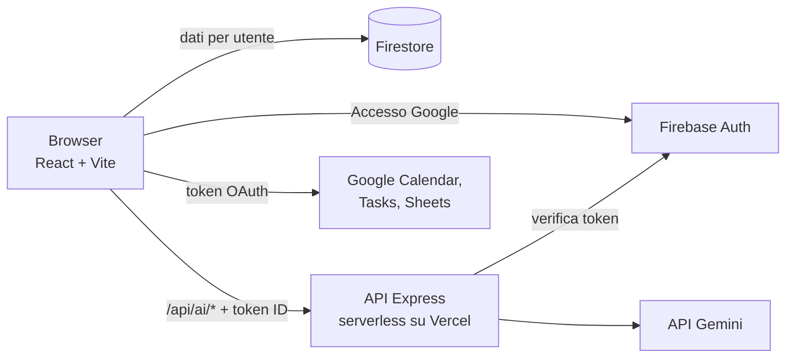

<a name="top"></a>
<div align="center">


**A personal CRM for the job search** · *Un CRM personale per la ricerca di lavoro*

[**▶ Live demo (English)**](https://interntrack-demo.vercel.app/?lang=en) · [**▶ Demo online (Italiano)**](https://interntrack-demo.vercel.app/?lang=it)

[](https://react.dev/)
[](https://www.typescriptlang.org/)
[](https://vitejs.dev/)
[](https://firebase.google.com/)
[](https://ai.google.dev/)

**[🇬🇧 English](#english) · [🇮🇹 Italiano](#italiano)**

</div>

---

# English



**Every application, contact and follow-up in one pipeline, turned into a short list of what to do today.**

> The demo runs on **sample data**: no real person, company or email address. Switch language any time with the **EN | IT** button in the top bar.

## Why I built it

Sales teams use a CRM so that no lead falls through the cracks. A job search has the same shape: dozens of opportunities at different stages, people to follow up with, deadlines to meet. Yet it usually lives in scattered spreadsheets and inboxes.

I built InternTrack as a CRM for my own search. Each application is an opportunity that moves through stages (**To apply → Applied → Interview → Offer → Rejected**), and the app turns that pipeline into the few things worth doing today.

## What it does

- **Tells you what to do today.** Deadlines and follow-ups (for example a reminder 7 days after applying) become a daily action list, synced to Google Calendar and Google Tasks for phone reminders.
- **Keeps every application in one place.** One tracker with table, action-center and card views, plus Excel / CSV / JSON import and export.
- **Keeps networking consistent.** A daily queue of 3 companies and 3 people, each with a short connection note, backed by a Google Sheet.
- **Uses AI where it saves time.** Job-posting extraction, tailored cover letters, interview practice and CV-to-role fit with Gemini.
- **Works in English and Italian**, switchable live.

**[▶ Try the demo](https://interntrack-demo.vercel.app/?lang=en)** (no sign-up). The AI features are switched off in the public demo to protect the API quota; they run on a private instance, see [`docs/SETUP.md`](docs/SETUP.md).

## Screenshots

| | |
|---|---|
| <br>**Tracker.** The pipeline at a glance, filtered by stage, with the next step for each application. | <br>**Search plan.** Daily research sessions with ready-made boolean queries for LinkedIn, Indeed and Joinrs. |

## How it works



## Engineering notes

- **Demo-first.** With no environment variables the app starts in demo mode: sample data, no login, AI off. The same codebase becomes a private instance just by adding variables.
- **AI routes are locked down.** `/api/ai/*` verifies the caller's Firebase ID token on the server and checks an email allowlist (`ALLOWED_EMAILS`), so nobody else can spend the Gemini quota. The key never reaches the browser.
- **Live, reversible translation.** UI strings are written in Italian; a dictionary translates what is rendered (`src/i18n/`) and restores the original text when you switch back, leaving app state and logic untouched.
- **Privacy and cost by design.** Personal profile, emails and sheet IDs live in environment variables or in the user's own database, never in the code. It uses the Firestore `(default)` database (the only one with a free quota) and keeps the restricted Gmail scope off unless enabled.

## Quick start

```bash
git clone https://github.com/MatteoBernabei/interntrack.git && cd interntrack
npm install --legacy-peer-deps
npm run dev          # http://localhost:3000, demo mode
```

Configuration, the private instance, Google verification and free-tier limits are in [`docs/SETUP.md`](docs/SETUP.md).

## Project status

A personal project that I use for my own search. Built with AI assistance (Google AI Studio and Claude), then reviewed, cleaned up and secured by me. Known limits: automated tests cover only the basics so far; Google's verification caps the public sign-in at 100 users, which is why Gmail is off by default; translation uses a runtime dictionary rather than a full i18n layer.

## License

All rights reserved. The code is public so that it can be read and evaluated; it may not be copied, modified or reused without the author's written permission. See [LICENSE](LICENSE).

[↑ Back to top](#top)

---

# Italiano


**Ogni candidatura, contatto e follow-up in un'unica pipeline, trasformata in una breve lista di cose da fare oggi.**

> La demo usa **dati di esempio**: nessuna persona, azienda o email è reale. Cambia lingua in qualsiasi momento con il pulsante **EN | IT** nella barra in alto. Gli screenshot sono in lingua inglese.

## Perché l'ho costruita

I team commerciali usano un CRM perché nessun contatto vada perso. Una ricerca di lavoro ha la stessa forma: decine di opportunità in fasi diverse, persone da ricontattare, scadenze da rispettare. Di solito però vive in fogli di calcolo e caselle email sparsi.

Ho costruito InternTrack come un CRM per la mia ricerca. Ogni candidatura è un'opportunità che avanza per fasi (**Da candidarmi → Candidato → Colloquio → Offerta → Rifiutato**), e l'app trasforma quella pipeline nelle poche cose che vale la pena fare oggi.

## Cosa fa

- **Ti dice cosa fare oggi.** Scadenze e follow-up (per esempio un promemoria 7 giorni dopo la candidatura) diventano un elenco di azioni quotidiane, sincronizzato con Google Calendar e Google Tasks per i promemoria sul telefono.
- **Tiene ogni candidatura in un posto solo.** Un tracker con viste tabella, centro azioni e schede, più import ed export Excel / CSV / JSON.
- **Rende costante il networking.** Una coda quotidiana di 3 aziende e 3 persone, ciascuna con una breve nota di connessione, appoggiata a un Google Sheet.
- **Usa l'AI dove fa risparmiare tempo.** Estrazione dagli annunci, cover letter su misura, simulazione di colloquio e compatibilità CV/ruolo con Gemini.
- **Funziona in inglese e in italiano**, con cambio al volo.

**[▶ Prova la demo](https://interntrack-demo.vercel.app/?lang=it)** (senza registrazione). Le funzioni AI sono spente nella demo pubblica per proteggere la quota delle API; girano su un'istanza privata, vedi [`docs/SETUP.md`](docs/SETUP.md).

## Screenshot

| | |
|---|---|
| <br>**Tracker.** La pipeline a colpo d'occhio, filtrata per fase, con il prossimo passo di ogni candidatura. | <br>**Piano di ricerca.** Sessioni di ricerca quotidiane con query booleane già pronte per LinkedIn, Indeed e Joinrs. |

## Come funziona



## Note tecniche

- **Pensata prima per la demo.** Senza variabili d'ambiente l'app parte in modalità demo: dati di esempio, nessun login, AI spenta. Lo stesso codice diventa un'istanza privata aggiungendo le variabili.
- **Rotte AI protette.** `/api/ai/*` verifica sul server il token di accesso Firebase e controlla un elenco di email (`ALLOWED_EMAILS`), così nessun altro può consumare la quota Gemini. La chiave non arriva mai al browser.
- **Traduzione dal vivo e reversibile.** I testi dell'interfaccia sono scritti in italiano; un dizionario traduce ciò che viene mostrato (`src/i18n/`) e ripristina l'originale quando si torna indietro, senza toccare stato e logica.
- **Privacy e costi per progetto.** Profilo personale, email e ID dei fogli stanno nelle variabili d'ambiente o nel database dell'utente, mai nel codice. Usa il database Firestore `(default)` (l'unico con quota gratuita) e tiene spento l'ambito Gmail restrittivo se non attivato.

## Avvio rapido

```bash
git clone https://github.com/MatteoBernabei/interntrack.git && cd interntrack
npm install --legacy-peer-deps
npm run dev          # http://localhost:3000, modalità demo
```

Configurazione, istanza privata, verifica Google e limiti dei piani gratuiti sono in [`docs/SETUP.md`](docs/SETUP.md).

## Stato del progetto

Progetto personale che uso per la mia ricerca. Realizzato con l'aiuto di strumenti AI (Google AI Studio e Claude), poi rivisto, ripulito e messo in sicurezza da me. Limiti noti: i test automatici coprono per ora solo le basi; la verifica di Google limita l'accesso pubblico a 100 utenti, per questo Gmail è spento di default; la traduzione usa un dizionario a runtime e non un vero livello i18n.

## Licenza

Tutti i diritti riservati. Il codice è pubblico perché possa essere letto e valutato; non può essere copiato, modificato o riutilizzato senza il permesso scritto dell'autore. Vedi [LICENSE](LICENSE).

[↑ Torna su](#top)
